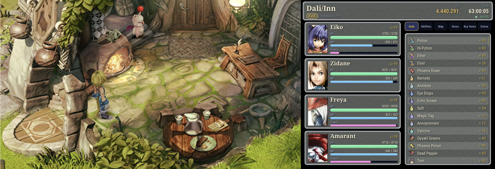
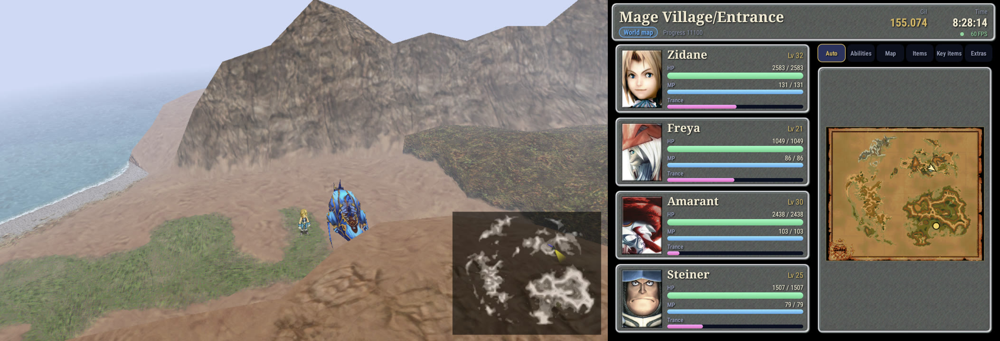
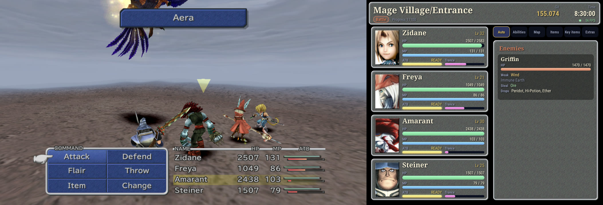
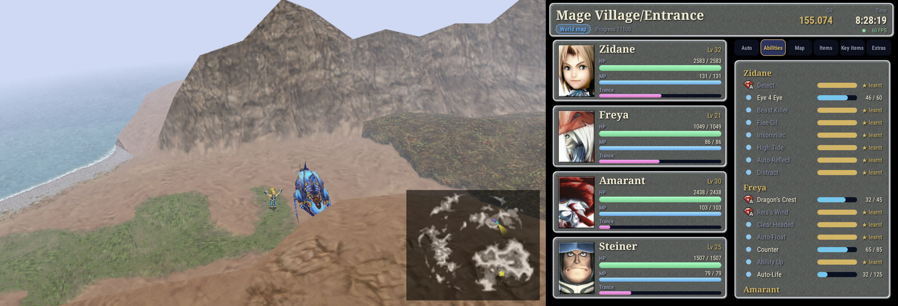
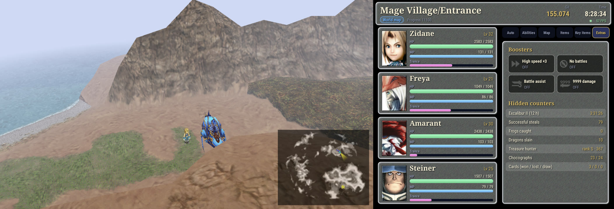

# Thor FF IX

**Final Fantasy IX on the dual-screen AYN Thor:** the game runs on the top screen (your own Steam copy
through [DroidDeck](https://github.com/Droid-Deck/DroidDeck), with the [Memoria](https://github.com/Albeoris/Memoria)
engine), and a live deck in the game's own look runs on the bottom screen: party, what your gear still
teaches, what the enemy is weak to and what you can steal, the world map, the booster buttons by touch
and the counters the game never shows.

> **Not affiliated with Square Enix.** FINAL FANTASY is a trademark of Square Enix Holdings Co., Ltd.
> This is an unofficial fan project. It contains **no game files and no game artwork**: the window skin,
> portraits and icons you see on the bottom screen are cut from *your own* game at runtime and are never
> stored in this repository or in the app.



| World map: where you are | Battle: weakness, what is left to steal, drops |
|---|---|
|  |  |

| Abilities: AP left on your gear | Extras: boosters by touch, hidden counters |
|---|---|
|  |  |

<sub>Real screenshots from an AYN Thor (FF IX via DroidDeck on top, Thor FF IX 0.2.2 below; the deck follows the game's language).</sub>

**Videos: [showcase](https://youtu.be/7KjomDMhI4s) · [install guide](https://youtu.be/cU4BpiBhWHk)**

**All Thor ports: [toravo.de/en/thor](https://toravo.de/en/thor/)**

## What the deck does

| Tab | Content |
|---|---|
| **Party** (always visible) | Portraits, level, HP/MP, status; in battle the ATB and Trance gauges |
| **Auto** | Switches by itself: enemies in battle, the map on the world map, items in the field |
| **Enemies** | HP, level, status – and what Scan would tell you: weak / absorbs / immune / halves, **what is left to steal** and what it drops |
| **Abilities** | Every ability your equipped gear teaches, with AP so far and AP needed – so you know when a piece can come off |
| **Map** | The world map with your position and heading, the chocobo and the airship |
| **Items / Key items** | Your inventory with the game's item icons |
| **Extras** | The game's **booster buttons by touch** (high speed, no encounters, battle assist, 9999 damage) and the **hidden counters**: Excalibur II countdown, successful steals (Thievery), frogs (Frog Drop), dragons (Dragon's Crest), treasure hunter rank, chocographs, card record |

The deck is read-only apart from the four booster buttons, which press the game's own buttons with the
game's own rules (they do nothing where the game does not allow them). It never takes the controller:
after a touch the focus goes back to the top screen.

Languages: the deck's labels follow the game's language – German when the game is German, English otherwise (names of items, abilities and places always come from the game).

## How it works

```
FF IX (Steam, Proton in DroidDeck)            Android
┌───────────────────────────────┐   127.0.0.1:8766   ┌─────────────────────┐
│ Memoria + Thor status server  │ ◄────────────────► │ Thor FF IX deck     │
│ (Assembly-CSharp.dll)         │  JSON events, PNG  │ (bottom screen)     │
└───────────────────────────────┘                    └─────────────────────┘
```

- `memoria/thor-status.patch` adds a small HTTP server to Memoria (off unless `[ThorStatus] Enabled = 1`
  in `Memoria.ini`, bound to 127.0.0.1): `/events` (state as Server-Sent Events), `/map/world.png`,
  `/ui/<atlas>/<sprite>.png` (the game's own UI graphics, cut at runtime) and `/cmd/booster/<name>`.
- `app/` is the Android app `de.harmssi.thorffix`: a starter that launches FF IX in DroidDeck on the top
  screen and the deck on the bottom screen.

## Install

You need: an AYN Thor (or another dual-screen Android handheld), your own **FINAL FANTASY IX on Steam**
installed in DroidDeck, a computer with `adb`.

1. **Memoria with the status server** (once):
   ```sh
   # the official Memoria patcher, release v2026.11.09: https://github.com/Albeoris/Memoria/releases/tag/v2026.11.09
   python3 memoria/memoria_extract.py Memoria.Patcher-osx-x64 /tmp/payload
   memoria/install_device.sh "<game folder on the device>" /tmp/payload Assembly-CSharp.dll
   ```
   `Assembly-CSharp.dll` is attached to the [release](../../releases/latest) (Memoria, MIT, built from
   upstream plus `memoria/thor-status.patch`), or build it yourself with `memoria/build.sh`.
   The game folder is usually
   `/storage/<sd card>/Android/data/com.droiddeck.launcher/files/steam/steamapps/common/FINAL FANTASY IX`.
   The originals Memoria replaces are kept as `*.thor-bak`; `memoria/uninstall_device.sh` puts them back.
2. **The deck:** `adb install ThorFFIX-0.2.2.apk` (from the release), then start **Thor FF IX**.
   DroidDeck opens its own control panel on the bottom screen; the deck puts itself in front of it as soon
   as the game is running. If you need DroidDeck's panel (Steam menu, trackpads), **hold the deck's header**
   for a second – closing the panel with **✕** brings the deck back.
3. **Mods (optional, recommended):** see below.

### Bring your save from the PC

FF IX does not use Steam Cloud (only its own *Cloud Data* menu), and under DroidDeck the save folder sits in
the launcher's private storage. So the patched Memoria imports a save you drop next to the game:

```sh
# on the PC: %USERPROFILE%\AppData\LocalLow\SquareEnix\FINAL FANTASY IX\Steam\EncryptedSavedData\SavedData_ww.dat
adb shell mkdir -p "<game folder on the device>/thor-import"
adb push SavedData_ww.dat "<game folder on the device>/thor-import/"
```

At the next start the file is moved into the save folder (it is renamed to `SavedData_ww.imported.dat`; the
save it replaced is kept as `SavedData_ww.before-import.dat`). If the save is not your own, also create an empty
file `thor-import/no-achievements`: while it exists the game reports no achievements or stats to Steam.

## The mods the community recommends

`mods/install_mods.sh` downloads them from their authors' own links (the ones Memoria's Mod Manager
uses) and copies them to the device. Nothing is redistributed by this project.

```sh
mods/install_mods.sh "<game folder on the device>"                       # Moguri + 30 fps videos + PSX sounds
mods/install_mods.sh "<game folder on the device>" moguri video sounds soundtrack psxbuttons echos
```

| Mod | What it does | Size on the device |
|---|---|---|
| **Memoria** (base) | 60 fps, widescreen, smooth camera, analog movement, battle swirl skip, hundreds of fixes | – |
| **Moguri Mod 9.0** (`moguri`) | The standard visual overhaul: HD backgrounds, redrawn layer edges, new model textures | 4.7 GB |
| **Moguri 30 fps videos** (`video`) | The FMVs at 30 instead of 15 fps | 2.8 GB |
| **Playstation Sounds** (`sounds`) | Replaces 1,500 sound effects of the PC port with the PSX originals | 137 MB |
| **Moguri Alt Soundtrack** (`soundtrack`) | 13 tracks as orchestral versions | 47 MB |
| **PSX Buttons** (`psxbuttons`) | PlayStation button icons instead of Xbox ones | 4 MB |
| **Modern German** (`german`) | German text in the current spelling | 3 MB |
| **Echo-S 9** (`echos`) | Voice acting by Tsunamods – a **demo** that covers about the first four hours, **English only** (the voices play when the game language is English) | 770 MB |

Gameplay overhauls (Alternate Fantasy, Trance Seek, …) are a matter of taste and are left out on
purpose; add their folder name to `[Mod] FolderNames` in `Memoria.ini` if you want them.

## Build

```sh
(cd app && ./build.sh)          # -> app/dist/ThorFFIX.apk   (Android SDK path in app/local.properties)
memoria/build.sh                # -> Assembly-CSharp.dll     (see memoria/README.md)
```

## Licences and thanks

- This project's own code (the app, the patch, the scripts): MIT, see `LICENSE`.
- [Memoria](https://github.com/Albeoris/Memoria) by Albeoris and contributors: MIT (`memoria/LICENSE.Memoria`).
- Moguri Mod by Ze_PilOt and Snouz, Playstation Sounds by DV, Echo-S 9 by Tsunamods, PSX Buttons by gdi,
  Modern German by Plasquar – thank you. They are downloaded from their authors, not shipped here.
- DroidDeck for running Steam games on Android.

⭐ If it works for you, a star on GitHub helps the project.
🔔 Subscribe for the next port: https://www.youtube.com/@toravomusic?sub_confirmation=1
